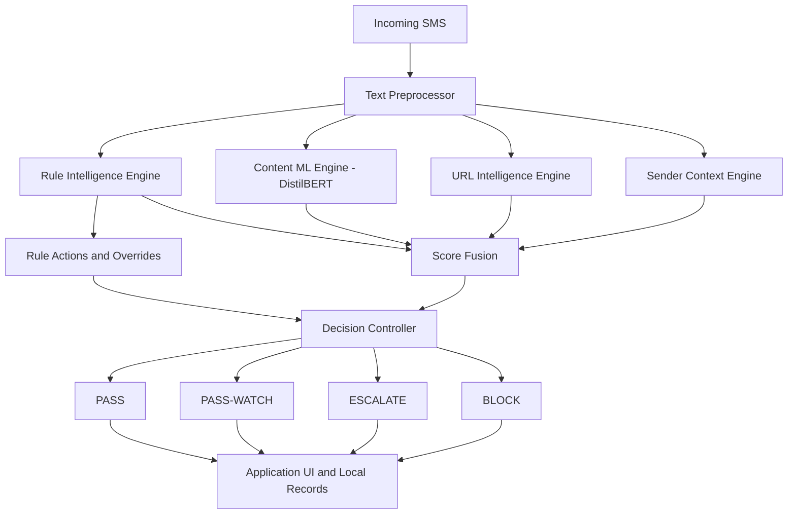

# SMS Guard — On-Device SMS Fraud Detection for Android

SMS Guard is a native Android application for detecting fraudulent SMS messages and smishing attempts using a hybrid neuro-symbolic detection pipeline. It combines deterministic rules, a fine-tuned DistilBERT model, URL intelligence, and sender context to produce risk-aware decisions directly on an Android device.

The project focuses on combining machine learning with explicit decision control, interpretable detection signals, and resource-conscious mobile deployment.

## Table of Contents

- [Overview](#overview)
- [Key Features](#key-features)
- [System Architecture](#system-architecture)
- [Detection Pipeline](#detection-pipeline)
- [Score Fusion and Decision Control](#score-fusion-and-decision-control)
- [Technology Stack](#technology-stack)
- [Android Application](#android-application)
- [Model Deployment and Optimization](#model-deployment-and-optimization)
- [Research Evaluation](#research-evaluation)
- [Physical-Device Validation](#physical-device-validation)
- [Project Structure](#project-structure)
- [Prerequisites](#prerequisites)
- [Installation and Setup](#installation-and-setup)
- [Building the Application](#building-the-application)
- [Running Tests](#running-tests)
- [Permissions and Privacy](#permissions-and-privacy)
- [Limitations](#limitations)
- [Future Improvements](#future-improvements)
- [License](#license)

## Overview

SMS fraud and smishing messages often use urgency, impersonation, credential requests, suspicious links, and financial threats to manipulate recipients. Traditional rule-based filters can be transparent and efficient but may struggle with changing language patterns. Neural text classifiers can capture more complex linguistic patterns but do not independently provide all the contextual signals required for an application-level decision.

SMS Guard combines these complementary approaches in a single Android application.

The system evaluates incoming messages using four engines:

1. **Rule Intelligence** — deterministic pattern matching for known fraud-related language and message patterns.
2. **Content ML** — DistilBERT-based classification of SMS text.
3. **URL Intelligence** — local analysis of URLs, domain patterns, high-risk top-level domains, and known URL shorteners.
4. **Sender Context** — contextual signals derived from the sender and, where available, the device's contacts.

Their outputs are combined through a score-fusion mechanism and processed by a decision controller that produces one of four outcomes: `PASS`, `PASS-WATCH`, `ESCALATE`, or `BLOCK`.

The application is designed for on-device inference. Its research evaluation and deployment measurements are documented separately to distinguish offline classification performance from actual Android execution.

## Key Features

- Hybrid neuro-symbolic SMS fraud detection.
- DistilBERT inference using ONNX Runtime on Android.
- Deterministic, rule-based fraud pattern detection.
- Local URL and domain-risk analysis.
- Sender-context signals using Android contact information.
- Weighted score fusion with a bounded rule adjustment.
- Four-state decision control.
- Risk explanations and component-level signal breakdowns.
- Android notification and message-management interfaces.
- Local persistence for application message references and detection records.
- Quantized ONNX model deployment for reduced model size.
- Research and device-oriented model build variants.
- Unit testing and physical-device performance validation.

The system provides risk assessments and warnings; it does not guarantee that every fraudulent message will be detected or that every message receiving a low-risk decision is safe.

## System Architecture

The application processes an incoming SMS through preprocessing, four detection engines, score fusion, and the decision controller.



The engines provide heterogeneous signals rather than relying exclusively on a single model score. The decision controller applies fixed-priority rules, confidence checks, and risk-based logic to determine the final outcome.

## Detection Pipeline

### 1. Text Preprocessing

Incoming message text is normalized before downstream analysis.

Preprocessing includes:
- Unicode normalization.
- Whitespace normalization.
- Handling of control characters.
- Canonical masking of selected entities, such as URLs, phone numbers, and OTP-like values, where supported by the preprocessing implementation.

The purpose is to provide a consistent text representation and reduce dependence on specific message identifiers.

### 2. Rule Intelligence Engine

The rule engine performs deterministic symbolic pattern matching against predefined fraud-related patterns.

The patterns cover categories such as:
- Urgency and time-pressure language.
- Financial fraud indicators.
- Credential harvesting and account verification.
- Bank or authority impersonation.
- Delivery-related scams.
- Account suspension and reactivation requests.

Rule outcomes can contribute to the risk score or trigger explicit decision actions. The rule engine operates independently of the neural model's prediction.

### 3. Content ML Engine

The content classifier uses a fine-tuned DistilBERT model based on `distilbert-base-uncased`.

The model produces a continuous fraud probability. The application uses this output as one input to score fusion rather than treating the standalone classification threshold as the entire application decision policy.

The Android implementation runs the model through ONNX Runtime, with a dynamically quantized INT8 variant available for the device-oriented build.

### 4. URL Intelligence Engine

The URL engine evaluates URL-related signals found in a message.

Depending on the extracted content, it can consider:
- URL and domain extraction.
- IP-based hosts.
- High-risk top-level domains.
- Recognized URL shorteners.
- Local known-domain pattern matching using a Bloom-filter-style lookup mechanism.

This is local heuristic analysis, not a claim of comprehensive or continuously updated Internet threat intelligence. The system does not establish that a URL is harmless simply because no known suspicious pattern was found.

### 5. Sender Context Engine

The sender-context engine contributes information about the sender.

In the deployed Android application, contact-related context can be obtained through the Android Contacts Provider when the user grants the required permission. A contact match can reduce the sender-risk signal.

The research evaluation also uses dataset-derived or simulated context where actual device contact information is unavailable. Such experimental context should not be interpreted as a measurement of real users' contact lists.

A saved contact is a contextual signal, not proof that a message is legitimate.

## Score Fusion and Decision Control

### Score Fusion

The system combines the outputs of the Content ML, URL Intelligence, and Sender Context engines with a bounded adjustment from the Rule Intelligence engine.

The final risk score is calculated as:

```text
risk_final = clip(
    0.30 * ml_score
  + 0.30 * url_risk
  + 0.40 * sender_risk
  + rule_delta,
  0.0,
  1.0
)
```

The rule adjustment is:

```text
rule_delta = clip(
    (rule_score - 0.5) * 0.20,
    -0.15,
    +0.15
)
```

Here, `clip(value, min, max)` restricts a value to the specified range.

- `ml_score`: Fraud probability produced by DistilBERT.
- `url_risk`: Risk derived from URL-related signals.
- `sender_risk`: Risk derived from sender context.
- `rule_score`: Score produced by the Rule Intelligence engine.
- `rule_delta`: Bounded adjustment contributed by the rule engine.

The weighted components use weights of 0.30, 0.30, and 0.40, respectively. The rule adjustment is separate from these weights and is limited to the range -0.15 to +0.15. The final risk score is restricted to the range 0 to 1.

### Decision Controller

The decision controller converts the available risk and context signals into one of four outcomes:

| Decision | Meaning |
|---|---|
| `PASS` | Normal message handling is permitted; this does not guarantee that the message is safe. |
| `PASS-WATCH` | The message receives a lower-risk outcome with additional caution. |
| `ESCALATE` | The message requires further attention or a warning. |
| `BLOCK` | The message is handled according to the application's blocking or quarantine policy. |

The controller uses risk boundaries of 0.25 and 0.65, alongside confidence checks and fixed-priority rules. Consequently, the final decision is not determined by the risk score alone: explicit rule actions, sender context, URL presence, and confidence gating can also affect the outcome.

### Decision States

The decision controller produces four outcomes:

| Decision | Meaning |
|---|---|
| `PASS` | The controller permits normal message handling. This is not a guarantee that the message is benign. |
| `PASS-WATCH` | The message receives a lower-risk outcome with monitoring or additional caution. |
| `ESCALATE` | The message requires additional attention because of risk, uncertainty, or decision-control logic. |
| `BLOCK` | The message receives a high-risk blocking or quarantine action according to the application policy. |

The controller uses risk boundaries at 0.25 and 0.65, alongside confidence checks and fixed-priority rule actions.

These thresholds do not independently determine every outcome. Explicit rule actions, trusted-sender conditions, URL presence, and confidence gating can affect the final decision. The controller must therefore be understood as a priority-based decision system, not simply a four-bin risk-score lookup.

## Technology Stack

| Component | Technology |
|---|---|
| Programming language | Kotlin |
| Android UI | Jetpack Compose and Material Design 3 |
| Architecture | Android application architecture with ViewModels |
| Dependency injection | Dagger Hilt |
| Local persistence | Room |
| Machine-learning model | Fine-tuned DistilBERT |
| Model runtime | ONNX Runtime for Android |
| Text processing | WordPiece-compatible tokenization and preprocessing |
| Concurrency | Kotlin Coroutines and Flow-based components |
| Build system | Gradle with Kotlin DSL |
| Testing | JUnit and the project's configured Android testing libraries |

Exact library versions are defined by the repository's Gradle configuration and version catalog.

## Android Application

SMS Guard includes application interfaces and supporting components for managing detection outcomes.

The application includes interfaces for:
- Onboarding and permission requests.
- Protection status and recent activity.
- Fraud-related message review.
- Message details and risk explanations.
- Settings and notification preferences.
- Local audit information.
- Developer and testing utilities where enabled.

Incoming SMS handling, model inference, contextual analysis, and final decision generation are implemented in the Android application.

Available functionality depends on the granted Android permissions, build variant, and device environment.

## Model Deployment and Optimization

### Model Variants

The project supports device-oriented and research-oriented model variants.

| Variant | Model format | Intended use |
|---|---|---|
| Device | Dynamically quantized INT8 ONNX | Reduced-size deployment on compatible Android devices |
| Research | FP32 ONNX | Research evaluation and comparison with the unquantized model |

The recorded model sizes are approximately:

- FP32 ONNX: 255.54 MB.
- INT8 ONNX: 64.21 MB.

Actual packaged APK sizes differ from model sizes because an APK also contains application code, resources, libraries, and other assets.

The device-oriented build uses the `arm64-v8a` ABI. The research variant supports the ABIs configured in the project's Gradle build.

### Quantization Trade-off

Dynamic INT8 quantization substantially reduces model size and can improve inference performance. However, quantization does not guarantee identical predictions to the FP32 model.

In the recorded research comparison, the INT8 model produced 34 standalone prediction changes among 11,165 test messages. Its measured standalone F1 score was 0.982849, compared with 0.983728 for the FP32 DistilBERT baseline.

These are measured results for the evaluated test set, not guarantees for other datasets or devices.

## Research Evaluation

The project was evaluated using a harmonized SMS corpus containing 74,431 messages after preprocessing and deduplication.

The corpus contained:
- 44,771 ham messages.
- 29,660 fraud messages.

The dataset was divided into training, validation, and test partitions of 70%, 15%, and 15%, respectively. The held-out test set contained 11,165 messages.

The experiments compare classical text-classification baselines, standalone DistilBERT, and the full hybrid system.

### Classification Results

The following table reports the recorded held-out test results.

| Model | Accuracy | Precision | Recall | F1 |
|---|---:|---:|---:|---:|
| Logistic Regression | 0.9783 | 0.9711 | 0.9746 | 0.9729 |
| Linear SVM | 0.9788 | 0.9724 | 0.9744 | 0.9734 |
| DistilBERT | 0.9870 | 0.9823 | 0.9852 | 0.9837 |
| Full Hybrid | 0.9815 | 0.9799 | 0.9735 | 0.9767 |

DistilBERT achieved the highest overall F1 score in this evaluation. The hybrid system should not be interpreted as outperforming the standalone transformer on aggregate classification metrics.

The hybrid approach instead combines multiple heterogeneous signals with explicit application-level decision control. Its value is in the integration of those signals, the availability of rule-based overrides, and the production of actionable decision states.

These results apply to the evaluated corpus and should not be interpreted as guaranteed performance on unseen real-world SMS traffic.

## Physical-Device Validation

The Android implementation was installed and exercised on a Xiaomi POCO X5 Pro 5G running Android 14.

The recorded validation included:
- Physical-device inference benchmarking.
- Live SMS processing measurements.
- Comparison of FP32 and INT8 model outputs.
- Application and unit-test verification.

### Controlled Inference Benchmark

A controlled physical-device benchmark measured the DistilBERT inference path using ONNX Runtime's CPU execution provider.

| Measurement | Recorded result |
|---|---:|
| Model inference mean | 229.856 ms |
| Model inference median | 209.349 ms |
| Model inference P95 | 404.139 ms |
| Measured runs | 100 |

These measurements cover the instrumented inference path and are not equivalent to end-to-end SMS processing latency.

### Live SMS Processing Benchmark

A separate experiment measured the interval from Android's delivery of the SMS-received broadcast to completion of the final detection decision.

| Measurement | Recorded result |
|---|---:|
| Successfully processed messages | 18 |
| Overall mean | 188.01 ms |
| Overall median | 148.84 ms |
| Warm-state mean, excluding the first run | 151.53 ms |
| Warm-state median | 147.83 ms |

The first run took substantially longer than the remaining observations, affecting the overall mean. The warm-state statistics are reported separately rather than hiding this variation.

This benchmark measures application processing after broadcast receipt. It does not measure carrier transmission time, network propagation, operating-system delay before broadcast delivery, or UI rendering.

The sample size is limited. Broader testing across devices, operating-system versions, message types, and long-running usage is still needed.

## Project Structure

The following is a simplified representation of the important application files. Actual paths should be checked against the current repository.

```text
sms-fraud-detector/
├── app/
│   ├── build.gradle.kts
│   ├── proguard-rules.pro
│   └── src/
│       ├── main/
│       │   ├── AndroidManifest.xml
│       │   ├── assets/
│       │   ├── java/com/smsfraud/detector/
│       │   │   ├── benchmark/
│       │   │   ├── data/
│       │   │   ├── di/
│       │   │   ├── domain/
│       │   │   ├── engine/
│       │   │   ├── ml/
│       │   │   ├── preprocessing/
│       │   │   ├── service/
│       │   │   ├── ui/
│       │   │   └── util/
│       │   └── res/
│       ├── research/
│       │   └── assets/
│       └── test/
├── deployment_package/
│   └── tokenizer/
├── gradle/
├── .gitattributes
├── .gitignore
├── build.gradle.kts
├── gradle.properties
├── gradlew.bat
├── README.md
└── settings.gradle.kts
```

### Important directories

- `app/src/main/`: Main Android application implementation.
- `app/src/main/assets/`: Assets used by the device build, including the required model and tokenizer files where configured.
- `app/src/main/java/com/smsfraud/detector/engine/`: Detection engines, fusion, and decision logic.
- `app/src/main/java/com/smsfraud/detector/ml/`: Model inference and tokenization components.
- `app/src/main/java/com/smsfraud/detector/service/`: SMS-related services, receivers, and notification handling.
- `app/src/main/java/com/smsfraud/detector/ui/`: Application screens and UI components.
- `app/src/test/`: Unit tests.
- `deployment_package/tokenizer/`: Tokenizer assets used by the configured project workflows.
- `gradle/`: Gradle wrapper support and version catalog.

## Prerequisites

Before building the application, install:

- Android Studio.
- JDK 17.
- Android SDK and Build Tools compatible with the project configuration.
- Git.
- Git LFS if required by the repository's model-file tracking configuration.
- A compatible Android device or emulator.

The project targets Android API 34 and declares a minimum SDK of API 26 in its current configuration. Check the Gradle files for the authoritative values.

## Installation and Setup

Clone the repository:

```bash
git clone https://github.com/Tejas2913/sms-fraud-detector.git
cd sms-fraud-detector
```

If the repository uses Git LFS for model files, install and initialize Git LFS before downloading the required assets:

```bash
git lfs install
git lfs pull
```

Open the project in Android Studio and allow Gradle synchronization to complete.

If model assets are not present after cloning, check the repository's LFS configuration and the documented model paths before attempting to build.

## Building the Application

### Device Debug Build

On Windows:

```powershell
.\gradlew.bat assembleDeviceDebug
```

On Linux or macOS:

```bash
./gradlew assembleDeviceDebug
```

### Device Release Build

On Windows:

```powershell
.\gradlew.bat assembleDeviceRelease
```

On Linux or macOS:

```bash
./gradlew assembleDeviceRelease
```

The release variant uses the project's configured optimization and packaging settings. A release build does not, by itself, establish production readiness.

### Research Debug Build

On Windows:

```powershell
.\gradlew.bat assembleResearchDebug
```

The research build requires the FP32 model assets configured for that variant.

The exact output paths depend on the module's current Gradle configuration. Check the build output if a variant or filename differs.

## Running Tests

To execute the device debug unit-test suite:

On Windows:

```powershell
.\gradlew.bat testDeviceDebugUnitTest
```

On Linux or macOS:

```bash
./gradlew testDeviceDebugUnitTest
```

The recorded project validation reported 235 passing unit tests. Run the command above to verify the current checkout rather than assuming that earlier results apply to every subsequent change.

## Permissions and Privacy

SMS Guard uses Android permissions for features that require access to incoming messages, message history, contacts, and notifications.

| Permission | Purpose |
|---|---|
| `RECEIVE_SMS` | Receive SMS broadcasts for incoming-message processing. |
| `READ_SMS` | Read message records for supported inbox and message-display features. |
| `READ_CONTACTS` | Resolve sender information against saved contacts when enabled and authorized. |
| `POST_NOTIFICATIONS` | Display supported notifications on Android versions that require this permission. |

Only grant permissions you understand and are comfortable with. Permission availability and background behavior depend on Android version, device settings, and application configuration.

The detection pipeline is designed for local execution. Message and contact handling should be reviewed against the current source code and Android permission behavior. This README does not make an independent guarantee that every application component is free of network communication.

Local persistence is used for application records and detection-related information. A Room database should not be assumed to be encrypted unless encryption is explicitly implemented and verified.

## Limitations

- The evaluation corpus does not represent all real-world SMS traffic.
- Model performance may change with language, region, message style, and emerging fraud patterns.
- The text-processing and tokenizer configuration is primarily oriented toward English-language SMS.
- Contact information is a contextual signal, not proof of sender legitimacy.
- URL heuristics cannot identify every malicious or newly registered domain.
- INT8 quantization can change some model predictions compared with FP32.
- The physical-device benchmark used a limited number of controlled inference runs and live SMS examples.
- The live SMS benchmark excludes carrier transmission and network-delivery time.
- Battery consumption, long-duration background reliability, memory use under varied workloads, and large-scale field performance require further evaluation.
- The application does not analyze OTT messaging platforms such as WhatsApp, Telegram, or Signal through their private messaging protocols.

## Future Improvements

Potential areas for further work include:

- Broader evaluation on independently collected and more diverse SMS datasets.
- Additional multilingual support.
- Expanded testing across Android devices and operating-system versions.
- Longer-duration background execution and resource-consumption measurements.
- Improved handling of new and obfuscated URL patterns.
- Additional evaluation of decision thresholds and rule overrides.
- Usability studies for risk explanations and user-facing warnings.
- Further verification of privacy, data-retention, and application-security properties.

These are potential improvements, not claims that the features are already implemented.

## License

Check the repository for a `LICENSE` file to determine the applicable license.

If no license file is present, the project should not be assumed to be available for unrestricted reuse, modification, or redistribution. Add a license only after deciding which terms are appropriate for the project and its dependencies.

---
